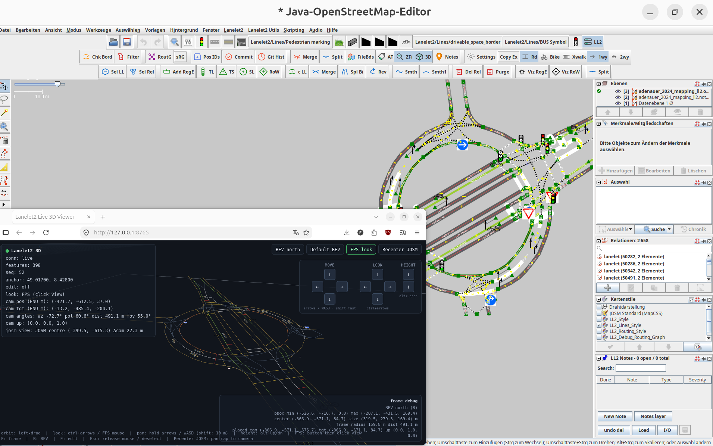
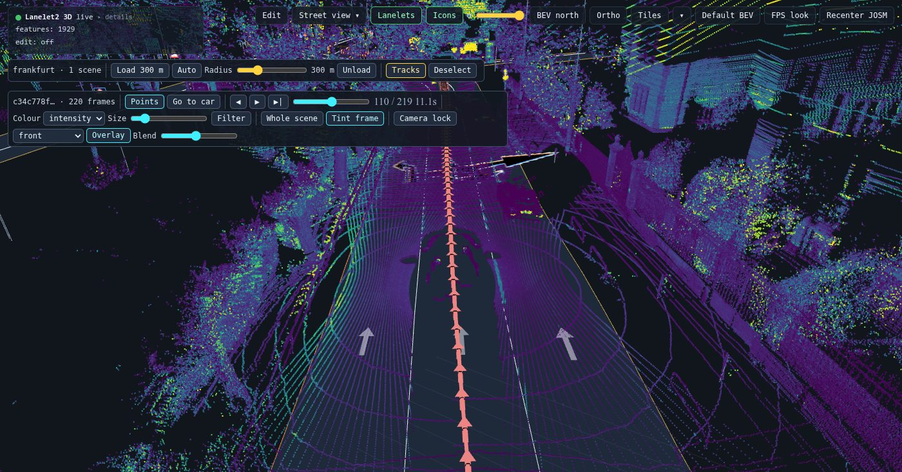
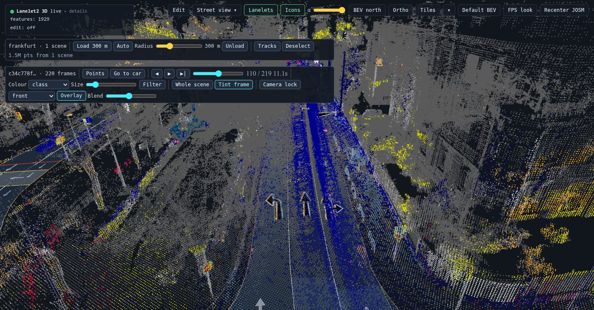
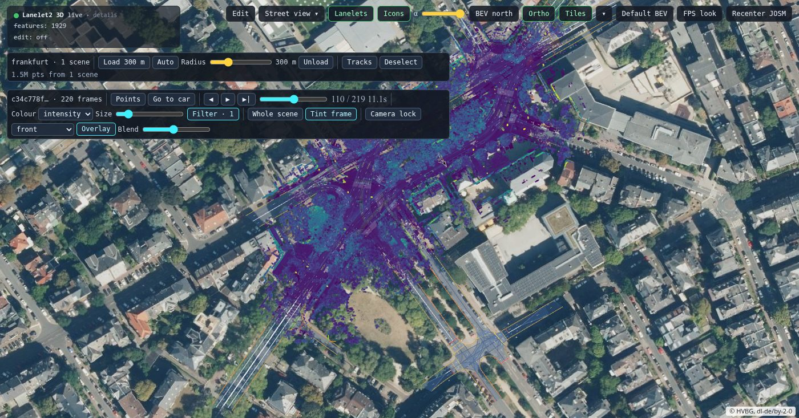

# JOSM Lanelet2 Plugin

Lanelet2 map editing tools for [JOSM](https://josm.openstreetmap.de/), as a
native Kotlin plugin (`lanelet2.jar`).



The plugin ships a live 3D viewer for the map, which can also show recorded
LiDAR point clouds and camera images from
[KITScenes](https://kitscenes.com/multimodal/) — see
[Recorded sensor data](#recorded-sensor-data-kitscenes-no-josm-needed).

Most tools are self-contained. Four actions (positive IDs, merge, split, debug
routing graph) also need a local Python `lanelet2` install; they warn at the
point of use if that sidecar is missing. Everything else works without it.
if its missing its easy to use the setup wizard for creating a venv with the system python
or any other python interpreter you might have installed, for example via `uv`.

## Requirements

The plugin is built with JDK21 so you need to install:

```
sudo apt install openjdk-21-jre
```

or insall JDK25 JRE, which is required by the Python3 scripting companion plugin (not a hard dependency):

```
sudo apt install openjdk-25-jre
```

as it depends on the more modern Java Runtime.

make sure that JOSM is launched with that (should work directly after installing the JDK21 JRE) 

| You want… | You need |
|---|---|
| Core editing, styles, presets, 3D viewer, notes, git helpers | [JOSM](https://josm.openstreetmap.de/) **19555** or newer |
| Positive IDs, OSM merge/split, **debug routing graph** | The above, plus Python **3.8–3.12** and the upstream [`lanelet2`](https://github.com/fzi-forschungszentrum-informatik/Lanelet2) wheel (Linux) |
| Ad-hoc **Python 3** scripts with numpy etc. against this plugin | The companion GraalPy JOSM plugin (`graalpy`) |
| Ad-hoc **Jython 2.7** scripts against this plugin, pure Jython no numpy| The [Scripting plugin](https://josm.openstreetmap.de/wiki/Help/Plugin/Scripting) with a Jython 2.7 engine |

## Install

`install.sh` copies `lanelet2.jar` into JOSM's default plugins directory. The
jar **must** keep that name — JOSM keys plugins off the filename.

```bash
# After a local build (./gradlew dist → build/dist/lanelet2.jar)
./install.sh

# A downloaded GitHub release jar (must stay named lanelet2.jar)
./install.sh /path/to/lanelet2.jar
```

The script follows JOSM's own user-data rule:

| OS | Plugins directory |
|---|---|
| Linux | `~/.josm/plugins` if that legacy home still exists, otherwise `${XDG_DATA_HOME:-~/.local/share}/JOSM/plugins` |

Override with `--dir DIR` or `JOSM_PLUGIN_DIR`. If the plugins directory (or
the JOSM user-data home around it) does not exist, the script **warns** —
JOSM has probably never been started on this account — then creates the
directory and copies the jar anyway.

Restart JOSM and enable **lanelet2** under *Edit → Preferences → Plugins* on
the first install (like any other JOSM plugin).

## What it ships

Menus appear at JOSM startup (**Lanelet2 Utils**, **Lanelet2 Map**). Extra
toolbars appear once a data layer is open; hide or show them with the **LL2**
toggle on JOSM's main toolbar, or *Lanelet2 Utils → Show Lanelet2 toolbars*.
Settings live in *Lanelet2 Utils → Lanelet2 Settings* and on the native
**Lanelet2** tab under *Edit → Preferences*.

### Lanelets

- Create lanelet(s) from a left/right linestring pair
- Merge a shared border (two lanelets) or merge swapped left/right bounds
- Revert lanelet direction; check borders (selects broken ones)
- Delete relations (drop memberships) or purge relations including member ways and nodes


### Regulatory elements

Wizards for traffic lights, traffic signs, speed limits, and right-of-way;
add an existing regulatory element to lanelets; convert bike traffic lights;
visualize regulatory connections and the right-of-way wizard.

Select-from-linestring and the traffic-light / sign / speed-limit wizards use
the current selection by default. Turn on **Use collection dialog** in settings
to collect members interactively instead. Right-of-way create/debug always open
the collector (two role groups cannot be expressed as a flat selection).

### Selection and tagging

- Select lanelets or relations from selected linestrings
- Quick-tag modal (Space)
- Toolbar defaults for new-lanelet subtype (`road` / `bicycle_lane` / `crosswalk`) and one-way vs bidirectional
- Autotag new elements (`file_origin` and friends) and a zoom-based filter hook
- Highlight file-boundary hulls (grouped by `file_origin`)
- Load an older git revision of the current file
- Notes panel (custom geolocated notes)

### Map appearance

Bundled MapCSS styles and tagging presets (including traffic-sign icons)
install on launch. Choose the style preset from the settings window.

### Maintenance

- Filter broken lanelets and regulatory elements (writes a backup and asks before applying)
- Git commit of the current file (optional save reminder)
- Routing-graph refresh hook (used with the debug graph)

### Live 3D viewer

*Lanelet2 Utils → Live 3D Viewer* starts a local stdlib `python3` server and
opens a Three.js view of the loaded map. It does **not** need the `lanelet2`
Python package. The browser client vendors [three.js](https://threejs.org/)
r160 (MIT, Copyright 2010–2023 Three.js Authors) under
`src/main/resources/lanelet2/viewer3d/static/vendor/` so the viewer works
offline. A whole city (Karlsruhe: 144k ways, 48k lanelets) renders without
culling.

- **Layout:** a top bar (connection, the scene breadcrumb, the *View | Edit*
  switch, the *Camera* and *Street view* menus, command search, keys,
  settings), the 3D view, a side panel on the right and a status bar. The
  panel has tabs — *Layers* (lanelets, icons, map tiles and their source),
  *Selection* (every tag of the selected lines, nodes or lanes, the
  relations they belong to, including the lane's traffic lights and signs,
  and a relation's members, asked from JOSM or the scene server; in View
  mode a click selects the line or the lane, not its nodes, Edit adds nodes
  and the tools), *Sensor data* (only with a recorded scene
  or city) and *Debug* (camera readouts; turn it on in Settings). Fold it away with `\` or by clicking the
  active tab; drag its edge to resize it. Everything is remembered per
  browser. In a narrow window the panel floats over the view.
- **Finding things:** `Ctrl+K` searches every command by name, `?` lists
  every key and mouse gesture, and the status bar shows the ones that apply
  right now (they change in Edit mode, in the 2D view and under the camera
  lock). Buttons explain themselves on hover, with their shortcut.
- **Lines** are drawn like the paint they stand for: at their real width,
  with real dash lengths, double lines and `solid_dashed` sides, the `color`
  tag, and never thinner than about a pixel when far away. Curbs, guard rails,
  barriers, walls and fences stand up in 3D (switch it off in *Layers* to see
  them as flat line styles). *Layers → Lines: Simple* goes back to one-pixel
  lines, the cheapest look; *Line types* shows the legend. The vocabulary
  follows `lines.mapcss`, with colours lifted where JOSM's would vanish on the
  dark background.
- **Compass** (bottom right): turns with the view; click it to face north.
  Next to it: *2D* (the map view, V), frame the map (F), top view (B).
- **Navigate:** left-drag orbits the point under the cursor (over sky it turns
  in place), right-drag looks, middle / shift-drag pans, the wheel zooms toward
  the cursor. WASD / arrows walk, Space / C up and down, alt+←/→ turn, Shift
  is fast. *Camera → FPS mouse look* captures the mouse. The walk speed is
  in Settings.
- **Edit (E, or *Edit* in the top bar):** the tools sit in a rail on the left
  of the view and the selection with its height (Z) in a card at the bottom.
  Click selects a node, else a way (cyan marks what a click
  would select); shift+click adds; ctrl+drag box-selects; middle-click cycles
  through overlapping items. The gizmo moves
  the whole selection (G), rotates it (R) or only changes heights (H). T makes
  the keys move the selection instead of the camera. I interpolates heights
  along the selected way. Z types a height (`112.35` sets, `+0.2` / `-0.2`
  shifts). M snaps gizmo moves to the nearest node's height, the lanelet
  surface, or (one node) onto another node; ctrl inverts it while dragging.
  Del, ctrl+Z and ctrl+Y go through JOSM (its delete
  warnings, its undo stack). Each gesture is one undo step; JOSM refusing it
  (hidden layer, deleted node) puts it back and says why.
- **Selection** is shared both ways: select in JOSM, adjust in 3D.
- **JOSM follows** the point the camera looks at (once it moved 30 m, or at
  once with *Camera → Centre JOSM on this view*), so turning the view at street level pans JOSM
  and its cull box too.
- **Icons (N)** are the oriented traffic sign / light / marking images, on by
  default, with an opacity slider (Layers) to fade them when they sit in front
  of a point cloud. The viewer finds the shipped `style_images` by itself now, so they
  also appear when the server is started by hand without JOSM. A traffic
  light or sign drawn the Autoware way — a 2-point line along its bottom
  edge plus a `height` tag — gets its icon as an upright box that tall,
  facing the approaching vehicle; every other one keeps the usual icon.
- **Lanelets (L)** show as surfaces with a direction arrow at 35 % of the
  lanelet2 centerline, double-headed where a car may drive both ways
  (lanelet2's rules, including `one_way:<participant>` overrides), violet
  where such an override gives some participant the other direction rule
  (e.g. `one_way:bicycle=no` on a one-way road).
- **Street view:** the viewer's *Street view* menu and the *SV* toolbar button open the
  selection or the view in Mapillary, Google Street View or Apple Maps.
- **2D (V)** is an orthographic map view: straight down, no perspective,
  north up to start. Left-drag pans like any map, right-drag turns it, `B`
  puts north up again, the wheel zooms about the cursor. The camera lock
  switches it off (the recorded camera has a perspective).
- **Tiles** lays a web map under everything: OpenStreetMap by default, or
  your own XYZ / TMS template or WMS endpoint (GeoServer and the like) from
  *Layers → Base map → Tile source*, with an opacity slider. A WMS can be asked in EPSG:3857 or in
  UTM (EPSG:25832 and friends, what German state servers serve); the
  Hessen and Baden-Württemberg 20 cm aerial images are presets, and so is
  *MRT Karlsruhe 2024*, the institute's own aerial images, which are **not
  publicly reachable** (KIT network or VPN only) and need the proxy below. Tiles are drawn in the scene, each
  corner placed through the same lat/lon → ENU as the map, so they line up
  in ortho and in perspective. They are off on every start, since turning
  them on sends the viewed area to the tile server. WebGL can only use tiles
  from servers that allow cross-origin use (CORS); for one that does not,
  list it under *Allowed tile hosts* in JOSM's *Live 3D Viewer* window
  (`srv1.mrt.kit.edu`, comma separated, `<host>:<port>` for a non-standard
  port), or start a viewer by hand with `--tile-proxy-host <host>` (or set
  `LL2_TILE_PROXY_HOSTS`). The viewer server then fetches tiles from that
  host only, for the page. Changing the list restarts the viewer server.

New nodes created in JOSM without `ele` get a height (on by default; settings:
*Heights*): a node inserted into a way, or joining ways, is interpolated
between the known heights on both sides, a free end or a lone node takes the
nearest node's height. An `ele` that is not a number or beyond ±100 km (some
tools write -3.4e38 for "unknown") counts as no height: the viewer draws such
a node at the height interpolated along its way. A height jump above 2 m between
neighbouring nodes after that, an interpolation or a 3D move raises a
warning, which also gives the distance and grade (a 3 m kerb-like step over
1 m reads differently from 3 m over a 100 m ramp).

### Recorded sensor data: KITScenes

The 3D viewer can show a recorded drive next to the map: the LiDAR point
clouds, the ring camera images and the ego trajectory of
[KITScenes Multimodal](https://kitscenes.com/multimodal/)
([dataset](https://huggingface.co/datasets/KIT-MRT/KITScenes-Multimodal),
[Python API](https://github.com/KIT-MRT/kitscenes),
[paper](https://arxiv.org/abs/2606.02956)) — one scene, or every scene of a
city. A separate process, `tools/scene_server/`, feeds the same viewer the
JOSM plugin uses, so **viewing needs no JOSM**; with JOSM connected, the map
stays JOSM's and editable while the sensor data comes from the scene server.


*City mode: a scene picked by clicking its trajectory, at frame 110 — the pose
arrows, that frame's LiDAR points (by intensity) and the Lanelet2 map.*


*Whole scene: every frame stacked into one static cloud, moving traffic
filtered out, coloured by Mapillary Vistas class (parked cars blue).*


*Orthographic map view over Hessen's 20 cm aerial images (WMS), the point
cloud faded so the lanes show.*

<sub>Screenshots: KITScenes Multimodal data (CC BY-NC 4.0); aerial images
© HVBG, dl-de/by-2-0.</sub>

**From JOSM** (the plugin jar is all it takes): open the city's Lanelet2 map,
then *Lanelet2 → KITScenes Sensor Data…* (toolbar: **KIT**). Choose the
KITScenes folder (the dataset root, one split, or one scene) and press
**Start**. The first Start offers a one-time setup (about a minute, ~500 MB,
internet access needed). It installs the KITScenes packages into the Lanelet2
backends' virtualenv, creating that first if there is none. Linux x64,
Python 3.8–3.12; when the system Python is newer and
[uv](https://docs.astral.sh/uv/) is installed, uv provides a 3.12. The scene
is then placed on JOSM's map, which stays editable; in city mode the map also
picks the city. The window shows the scene server's log; it stops with JOSM.

**Without JOSM** (setup once: `tools/scene_server/setup.sh`, which needs `uv`
and a `kitscenes` checkout next to this repository):

```bash
python3 src/main/resources/lanelet2/viewer3d/server.py      # or JOSM's 3D viewer
cd tools/scene_server
.venv/bin/python -m ll2_scene --scene $KITSCENES_ROOT/data/val/<scene-id>
.venv/bin/python -m ll2_scene --city $KITSCENES_ROOT --map /path/to/city/lanelet2_map.osm
```

**Where things are:** a scene brings a **timeline** under the view (step,
play, scrub; *Car* and *Follow*), a **camera bar** over it with one button per
ring camera, laid out like the car, and the side panel's **Sensor data** tab
(point clouds, colours with a legend, classes, filters; in city mode the
city's scenes as a searchable list). The breadcrumb in the top bar reads
*city › scene*; click the city to close the scene. Long builds show their
progress in the status bar.

**What you do most:**

| | |
|---|---|
| `,` `.` / ▶ | step / play frames; `K` puts the camera behind the car |
| *Follow* / `Shift+K` | the camera rides along with the car, keeping its place relative to it |
| `Shift+P` *Whole scene* | the static cloud of the whole scene (built once, then cached) |
| *Colour* | intensity, height, sensor, Vistas class, camera rgb, instance |
| *Classes*, *Filter* | hide classes — or *Only* the ticked ones — points above the ground or below an intensity, and fade the points |
| a ring camera button / `Shift+L` | the view exactly as that camera saw it, its image blended over (`O`); `Esc` lets go |
| click a trajectory, or a scene in the list | city mode: that scene (at that frame); *Load* / *Auto* bring the clouds around the camera |
| `V` *2D*, *Map tiles* | top-down map view; OSM, aerial images or your own WMS/TMS underneath |

Everything else — options, cache, how the static cloud is built, routes,
coordinates, performance — is in
[`tools/scene_server/README.md`](tools/scene_server/README.md); the design
log is [`docs/sensor-viewer-plan.md`](docs/sensor-viewer-plan.md). For the
browser side, start at `src/main/resources/lanelet2/viewer3d/static/js/sensors/`
(scenes, city, camera lock) and `js/render/` (points, trajectories, tiles).

### Needs the `lanelet2` sidecar

These four call the upstream library through a private virtualenv
(`$XDG_DATA_HOME/josm-lanelet2/venv`, or `~/.local/share/josm-lanelet2/venv`).
Use *Set up Lanelet2 backends* in the settings window.

- Make Positive IDs
- Merge OSM Files
- Split Merged OSM File
- Generate Debug Routing Graph (and the small and fast debug routing graph variant)

The upstream wheel is Linux-only and supports Python 3.8–3.12. Point the
wizard's *Advanced* section at another interpreter to use your own.

## Building from source

Requires JDK 21. The build compiles against JOSM 19555 (also the minimum
runtime). The repo must have at least one git commit: the JOSM Gradle plugin
reads `HEAD` when writing the plugin manifest.

```bash
./gradlew build          # compile + test (also produces build/dist/lanelet2.jar)
./gradlew dist           # plugin jar only
./gradlew runJosm        # launch JOSM with this plugin loaded
./gradlew debugJosm      # same, waiting for a debugger on port 1740
./install.sh             # copy build/dist/lanelet2.jar into the real JOSM plugins dir
```

A GitHub release is a tag `v0.1.0` (no `v` in the plugin version itself).
That runs `.github/workflows/release.yml`, which builds with
`RELEASE_VERSION` from the tag and uploads `lanelet2.jar`. Keep that
filename — JOSM keys plugins off it.

`runJosm` uses `build/.josm/userdata`, so it does not touch your everyday JOSM
profile. The sidecar venv stays outside that tree on purpose (`./gradlew clean`
must not delete a 100+ MB pip install).

Because a JOSM plugin is a single jar and JOSM does not ship the Kotlin
runtime, the plugin packs the Kotlin stdlib.

note that the GraalPy Plugin for scripting with Python3 requires JDK25. 

## Testing

```bash
./gradlew test                                   # JVM tests (headless)
python3 testdata/golden/run_golden.py            # Python backend regression corpus
```

`testdata/golden/` pins the behaviour of the four `lanelet2` backends. The JVM
suite does not need a running JOSM GUI.

## Scripting

Ad-hoc scripts can call this plugin's `Lanelet2Extensions` facade. Two
in-process engines work; they share the live JOSM `DataSet`, not a file
round-trip.

| | Companion GraalPy plugin (`graalpy`) | [Scripting plugin](https://josm.openstreetmap.de/wiki/Help/Plugin/Scripting) |
|---|---|---|
| Language | **Python 3** (GraalPy 25, currently 3.13) | **Jython 2.7** only |
| How to run | *Tools → Run Python file…* (also bundled hello / centroid) | *Scripting → Run Script* after adding a Jython engine jar |
| NumPy / PyData | Yes (GraalPy wheels; NumPy ships with that plugin) | No |
| This plugin's classes | After both plugins load — see below | After both plugins load — see below |

This plugin injects its classloader into both hosts (`scripting` and
`graalpy`). The GraalPy plugin also pulls every other `PluginClassLoader`
into its own. Either direction is enough; doing both covers load order.
Startup still succeeds if neither script engine is installed.

```
from org.openstreetmap.josm.plugins.lanelet2.api import Lanelet2Extensions
```

### Python 3 via GraalPy

The companion GraalPy plugin evals Python 3 inside the same JVM (Polyglot /
GraalPy), with `from org.openstreetmap.josm…` imports and optional NumPy.
It is a separate plugin (`graalpy`); this one does not embed GraalVM.

1. Load **lanelet2** and **graalpy** in the same JOSM.
2. Open a data layer, then *Tools → Run Python file…* and pick
   `examples/graalpy/hello_lanelet2.py`.

That example is Python 3 (`f"…"`, generator expressions). It imports
`Lanelet2Extensions` the same way as the Jython script and reports the
current selection. Load both plugins in one JOSM (`./install.sh` in each
repository).

Ideas that need SciPy / Shapely / NetworkX ship with the GraalPy plugin
under its `inspiration/` directory.

### Jython 2.7 via the Scripting plugin

Scripting plugin v0.4.x does not bundle Jython; add a `jython-standalone` jar
under *Preferences → Scripting → Script engines* first.

1. Install this plugin and the Scripting plugin, then add a Jython 2.7 engine.
2. Restart JOSM.

`examples/jython/hello_lanelet2.py` registers a **Hello Lanelet2 (example)**
item on *Lanelet2 Utils*. The same file ships inside the jar: *Lanelet2 Utils →
Copy example script to…*, then *Scripting → Run Script*. Do not use Python 3
syntax in this file.

```
from org.openstreetmap.josm.plugins.lanelet2.api import Lanelet2Extensions
```

| Method | Purpose |
| --- | --- |
| `register(slotId, title, callback, anchor)` | Add a menu item. `callback` is a zero-arg function (SAM). |
| `unregister(slotId)` | Remove a previously registered item. |
| `after(slotId)` / `before(slotId)` | Anchor relative to a first-party slot. |
| `anchors()` | Stable slot-ids you can pass to `after` / `before`. |
| `settings().get/put/getBoolean/putBoolean/getInt/putInt` | Plugin prefs. Booleans are `"1"` / `"0"`. |
| `geometry().centerlineOf(lanelet)` | Centerline vertices (lon, lat). |
| `geometry().centerlineLengthMeters(lanelet)` | Great-circle length in metres. |
| `geometry().calculateCenterlinePoints(left, right)` | Centerline from two polylines. |
| `geometry().wayMiddlePoint(pts)` | Middle vertex (Jython index `len // 2` quirk). |
| `lanelets().fromSelection(data)` | Lanelets from the dataset's current selection. |
| `lanelets().fromCurrentSelection()` | Same, on the active edit layer. |
| `lanelets().wrap(relation)` | Wrap a `type=lanelet` relation. |

Jython scripts must stay on Python 2 syntax. GraalPy scripts use Python 3.
JOSM's own `getBoolean` treats only `"true"` as true — always go through
`Lanelet2Extensions.settings()` for plugin keys.

## License

GPL-3.0-or-later (see [LICENSE](LICENSE)), Copyright (C) 2026 Karlsruhe
Institute of Technology (KIT), Institute of Measurement and Control Systems
(MRT). This plugin runs inside JOSM (licensed GPL-2.0-or-later), so it is
licensed GPLv3 to stay compatible with JOSM's "or later" license.

Maintainer: Richard Schwarzkopf (`schwarzkopf@fzi.de`).

The live 3D viewer vendors [three.js](https://threejs.org/) r160 (MIT,
Copyright 2010–2023 Three.js Authors). Those files keep their own license
headers under `src/main/resources/lanelet2/viewer3d/static/vendor/`.
